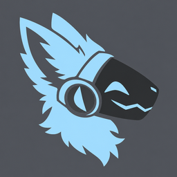

<p align="center">
  
</p>

<h1 align="center">BittenOS</h1>

<p align="center">
Open firmware for my protogen mask — a FurBitten Studios premade face<br>
(14 × MAX7219 8×8 LED panels) driven by an ESP32-S3.
</p>

---

The face came with an Arduino Nano running FurBitten's closed-source firmware. This repo replaces that controller with firmware I can change. It contains no FurBitten code, and the Nano is kept untouched as a backup.

| | |
|---|---|
| [`MY_PROTOGEN_SETUP.md`](MY_PROTOGEN_SETUP.md) | Full build log, wiring and day-to-day usage of my own mask |
| [`CHANGES-FROM-UPSTREAM.md`](CHANGES-FROM-UPSTREAM.md) | What this fork changed from ProtoESP, and why |
| [`troublefaq.md`](troublefaq.md) | When something goes wrong |
| [`IDEAS.md`](IDEAS.md) | Not built yet, and decisions already made |

---

## Features

### Faces

- All 14 panels driven as one face — 2 per eye, 4 per mouth side, 1 per nose side
- **14 faces**, most keeping the eyes and nose the mask came with, animating and blinking by themselves. `warning` scrolls WARNING under a donated angry face; `bsod` lights every panel and punches ERROR through it, so the message is the unlit part; `paneltest` labels each panel for working out a layout
- A short dip to black between faces, 20–400 ms
- **Mouth bob**, a **sleeping face** (on demand, or once the mask has been still a while), and **scrolling text** across the maw at four speeds
- **The Animator** — draw faces on a phone: pen, line, box, fill, mirror drawing, onion skin, undo, a frame strip you can drag to reorder, and a live preview

### Sensors

- **Tilt** from a BMI270
- **Boops** from an APDS-9930, using proximity *and* light: a boop must come close **and** cast a shadow, so stray readings don't count. A counter pops up on the nose once the paw moves away
- **Auto-brightness** from the same light sensor, with three ways of keeping the panels' own glow out of the reading
- **Microphone** (SPH0645 on I2S) driving speech shapes and rave mode
- The I2C bus is swept every 10 seconds, so a sensor that drops out reconnects without a restart

### Cheek strip

One WS2812B chain down both cheeks, 10 LEDs a side under the eyes.

- **Blush on boop** — the cheeks come up pink and hold for as long as the paw is there, then fade
- **Glow as a paw comes in** — the boop sensor reports a distance, not just booped or not, so the cheeks warm from almost nothing as a hand closes in
- **Rave meter** — an audio level up both cheeks: green, yellow, then red at the top
- **Pick the blush LEDs off a diagram** of the chain, drawn as it sits on the mask. Tap a square and that LED lights white, so which is which is never in doubt
- Manual brightness with no cap, and optional **room-following** off the ambient light sensor

### Web page

Its own WiFi network, `ProtoWiFi`, and a phone-friendly page at `192.168.4.1`.

- Face tiles with previews, and a face manager for uploading, renaming and deleting without reflashing
- Three tabs sized for one hand — Mask, Settings, System
- Settings save the moment they change, with anything not fitted folded away
- A live boop meter showing closeness and shadow against their trigger lines
- A System tab: uptime, temperature, memory, storage, what answered on I2C, raw sensor readings
- Installs to a phone's home screen with its own icon

### Button remote

A XIAO ESP32C6 in deep sleep until pressed, paired to this mask alone.

- Press, hold and double tap on each of three buttons — nine actions, each chosen on the web page
- Paired by MAC, so only this mask hears it. Pairing is all three buttons for three seconds, so the case can stay sealed
- Finds the mask again by itself if the WiFi channel moves
- The page shows signal strength, the last press, and how many went missing
- About 15 µA asleep, with no power switch

### For the fun of it

- **Rave mode** — the mic drives the maw as a VU bar or a 16-band spectrum while the eyes keep whatever face is up. With **Use mic** off it plays a made-up groove and never touches the mic
- **Fake low battery** — six seconds of staged failure: a twitch, panels dropping out, a battery draining on each maw, tearing, the face stuttering off, then the picture squeezing to a line. Red cheeks throughout. It comes back by itself, and any press cuts it short
- **Slot machine** across the maw, one spin in three landing triple sevens
- **Dino game** on both maws, button or remote to jump
- **Boop sass** — boop it too fast and it pulls a face at you
- A fake **boot sequence** (a bar filling outward from the nose) and a **CRT wake-up flicker**

### Updates

Over the air from the web page. A firmware update that doesn't run properly rolls itself back; a filesystem update keeps your settings.

---

## Hardware

| Part | Details |
|---|---|
| Controller | ESP32-S3-N16R8 (16MB flash, 8MB PSRAM — PSRAM required). Built on a Lonely Binary "Gold Edition"; `platformio.ini` sets `flash_mode = dio`, which both it and a HiLetgo DevKitC boot from |
| Display | FurBitten Studios premade face: 14 × MAX7219 8×8 panels, already chained |
| Tilt | BMI270 on I2C, 3V3 |
| Boop | APDS-9930 on the same I2C wires, 3V3 — **not** 5V tolerant |
| Microphone | SPH0645 on I2S |
| Status screen | 0.96" SSD1306 OLED, same I2C wires, address 0x3C |
| Cheek strip | WS2812B, 20 LEDs in one chain, from its own 5V supply with grounds bonded |
| Button | Momentary across GPIO 21 and 47 (optional) |
| Remote | Seeed XIAO ESP32C6 — its own project in `BittenOS-Remote/` |
| Power | 5V, about 3W with the stock faces at brightness 5 |

**Pins**

| GPIO | Use |
|---|---|
| 12 / 13 / 14 | MAX7219 CLK / CS / DIN |
| 9 / 10 | I2C SDA / SCL — tilt, boop, OLED |
| 4 / 5 / 6 | Mic BCLK / DOUT / LRCL |
| 18 | Cheek strip data |
| 21 / 47 | Button, and its ground |

Running the panels from the board's 5V pin works at normal brightness. For all-pixels-on faces or higher brightness, feed them from the 5V supply directly.

**Panel layout** — the chain runs left eye (back, front) → left mouth (back to front) → left nose → right nose → right mouth (front to back) → right eye (front, back). Seen from the front, which is how the Animator draws it:

```
t13 t12  .   .   .   .   .   .  t1  t0      eyes
 .   .   .  t7   .   .  t6   .   .   .      noses
t11 t10 t9  t8   .   .  t5  t4  t3  t2      mouth
```

---

## Setting it up

**1 — Install [PlatformIO](https://platformio.org/):** the VS Code extension, or `pip install platformio`.

On Windows, build from PowerShell or VS Code, **not Git Bash**, and turn on long path support, or the toolchain install fails.

**2 — Flash the firmware and the filesystem**, from the `BittenOS-Controller` folder:

```
pio run -e esp32-s3 -t upload
pio run -e esp32-s3 -t uploadfs
```

> ⚠️ **`uploadfs` replaces everything stored on the board, including your settings.** On a mask that's already set up, read them off first: `tools/read_board_config.py` pulls `config.json` out of a filesystem image so it can be built back in. [`MY_PROTOGEN_SETUP.md`](MY_PROTOGEN_SETUP.md) has the full procedure.

**3 — Join the WiFi network** `ProtoWiFi` (password `Proto1234`) and open `http://192.168.4.1`.

**4 — Set up what's fitted.** Switch on each sensor you have, calibrate tilt and the boop resting level, and pick the blush LEDs off the diagram. It's all under Settings, and all of it saves as you go.

### Updating over WiFi

Once the board has the 16MB partition table, updates don't need a cable. Go to **Tools → Update firmware** and pick a file from `.pio/build/esp32-s3/`:

- **`firmware.bin`** goes into whichever firmware slot isn't running and only takes over once it has fully arrived. If it resets within 30 seconds of starting, the mask switches back by itself.
- **`littlefs.bin`** replaces the faces and web pages, via a staging area. Settings, calibration and the boop count are kept.

The page works out which kind of file it is from its contents, and refuses anything else.

**Moving an existing mask onto the 16MB table needs one flash over USB**, because the filesystem moved from `0x410000` to `0x610000` and the settings have to be read from the old address first.

---

## Tools

In `BittenOS-Controller/tools/`, run from the `BittenOS-Controller` folder.

| Script | Does |
|---|---|
| `make_faces.py` | Builds the faces — eyes, nose, mouths and animation timing. `--preview <face>` prints one as text |
| `make_sleep_face.py` | Builds the sleeping face. Run **after** `make_faces.py` |
| `render_faces.py` | Draws the faces to a PNG, one dot per LED, to check them without the mask |
| `read_board_config.py` | Pulls `config.json` out of a filesystem image read off the board, so settings survive a flash |
| `virtual_tester.py` | Runs the web pages on your PC against a pretend mask |
| `sim_rave.py` | Rave mode's maths, ported line for line and run on raw mic counts. Re-run after changing a `RAVE_` constant |
| `convert_mk2_to_14.py` | Converts faces drawn for the stock 11-panel layout to this one |
| `make_face_maker.py` | Builds `face-maker.html`, the Animator as one standalone file to hand to other people |
| `make_icons.py`, `make_screen_font.py` | The home-screen icons, and the 5×7 font for the screen and scrolling text |

**Testing without the mask:**

```
cd BittenOS-Controller
python tools/virtual_tester.py
```

`http://localhost:8080/__tester` shows the page beside a virtual 14-panel face at the current brightness, with a log of every request. It simulates the button, boops, the counter and mouth bob. Pages are served live from `data/`, so edits show on reload; faces and settings live in `tools/.virtual_board/`, so testing never touches `data/`. Firmware changes still need a real build.

---

## Repository layout

| Path | Contents |
|---|---|
| `BittenOS-Controller/` | The firmware (PlatformIO), with web pages and faces in `data/` |
| `BittenOS-Controller/tools/` | Face building, rendering, conversion, icons, the virtual tester |
| `BittenOS-Controller/16MB_ota.csv` | The partition table |
| `BittenOS-Controller/anims_14panel_v1/` | The faces as they came, converted to 14 panels |
| `BittenOS-Controller/anims_original_11panel/` | The stock faces before conversion |
| `BittenOS-Remote/` | The ESP-NOW button remote |

---

## Credits and license

BittenOS is licensed under **GPL-3.0** — see [`LICENSE`](LICENSE).

It began as a fork of **[ProtoESP (ProtogenHelmet-ESP32)](https://github.com/NCPlyn/ProtogenHelmet-ESP32)** by **[NCPlyn](https://github.com/NCPlyn)**. None of this would exist without his work, and the licence comes from there too.

If you want a protogen controller of your own rather than one bent around this particular mask, start with his — it supports WS2812 matrices, ear rings, blush LEDs and a good deal more hardware than this fork kept.

The scrolling-text font is the system font from [MD_MAX72XX](https://github.com/MajicDesigns/MD_MAX72XX) by MajicDesigns (LGPL-2.1).

The face hardware is by FurBitten Studios. Their firmware is not included here.

---

*An AI assistant was used to help write this firmware.*
